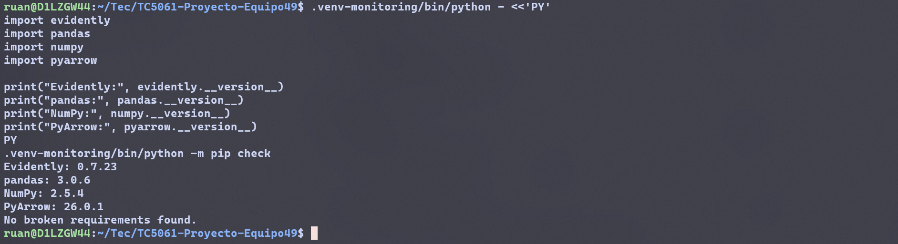
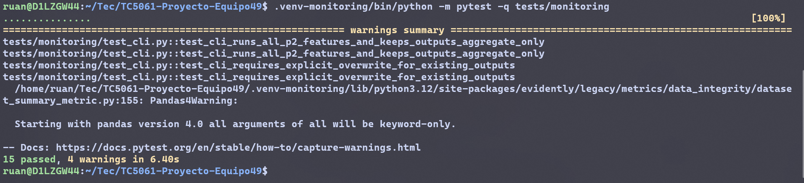
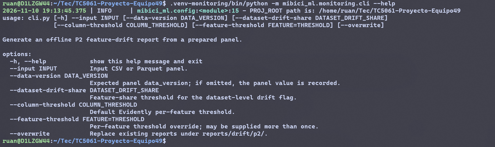
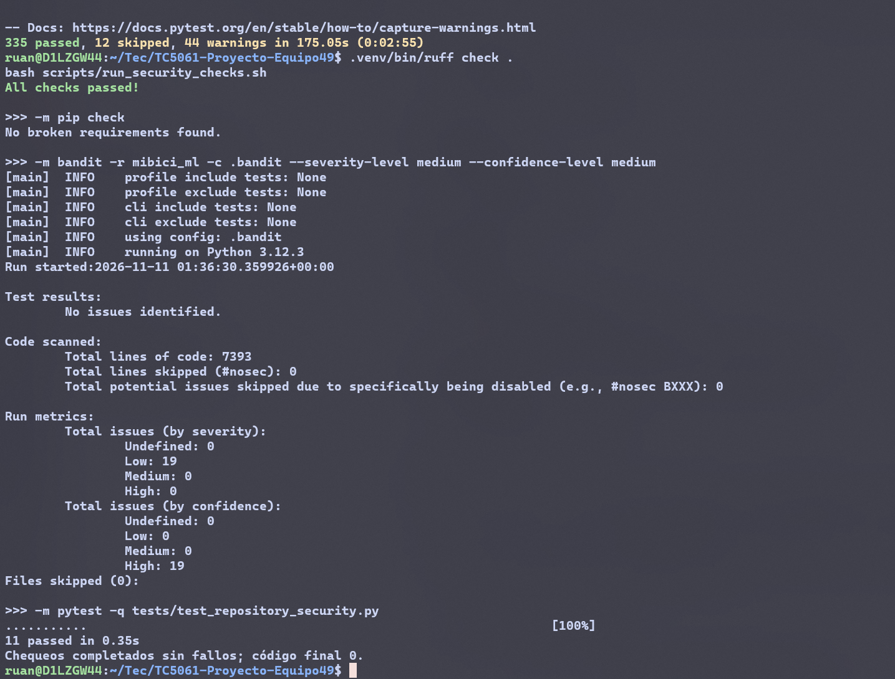

# Actividad 10 - Monitoreo offline de drift P2

## 1. Objetivo

El pipeline compara de forma offline las 14 features de P2 v2 mediante Evidently. No modifica modelos, MLflow ni el Model Registry.

## 2. Alcance implementado

- Entorno aislado para las dependencias de monitoreo.
- Contratos y validación de ventanas temporales y del panel.
- Integración con Evidently para calcular drift y resumen de features.
- CLI para consultar opciones y configurar la generación de reportes.
- Outputs agregados con controles de privacidad y ruta local restringida.
- Pruebas automatizadas de ventanas, CLI, outputs, privacidad e integración Evidently.

## 3. Ventanas temporales

| Ventana | Inicio | Fin | Rol |
|---|---|---|---|
| Referencia | 2025-10-01 | 2026-06-30 | `reference` |
| Actual histórica | 2026-09-01 | 2026-09-30 | `historical_test` |

Los límites son inclusivos y las ventanas no deben solaparse. `historical_test` identifica una comparación retrospectiva y no representa telemetría de producción.

## 4. Contrato de entrada

El panel puede estar en CSV o Parquet e incluye `ts`, las 14 features de P2 v2 en el orden contractual y una `data_version` consistente. Las features deben ser numéricas y finitas; sus nombres y orden deben coincidir con `models/serving/p2/model_metadata.json`. Si el panel no contiene `data_version`, el CLI permite proporcionarla con `--data-version`.

La columna `label` se excluye del análisis. Es un proxy de inventario inferido a partir de viajes, no una observación real del inventario.

## 5. Privacidad

Se excluyen del cálculo de drift y de las salidas los identificadores y campos no incluidos entre las 14 features: `est`, `station_id`, `nombre`, `lat`, `lon`, `ts`, `label`, rutas, hashes, `artifact_uri`, `source_run_id` y `mlflow_tracking_uri`. Los reportes no serializan filas fuente ni timestamps individuales.

## 6. Reproducibilidad

Cada ventana analiza como máximo 150000 filas; cuando supera ese límite, el muestreo determinista usa la semilla 42. El metadata registra las ventanas, conteos, versión de datos, semilla y revisión Git. La consulta de la revisión Git tiene un timeout de 10 segundos; los errores se presentan de forma sanitizada.

## 7. Entorno aislado

Desde la raíz del repositorio en WSL:

```bash
python3.12 -m venv .venv-monitoring
.venv-monitoring/bin/python -m pip install -r requirements-monitoring.txt
.venv-monitoring/bin/python -m pip check
```

El entorno fija Evidently 0.7.23 y pandas 3.0.6.

## 8. Interfaz CLI

```bash
.venv-monitoring/bin/python -m mibici_ml.monitoring.cli --help
```

El CLI acepta `--input` para el panel, `--data-version` para validar o registrar su versión, `--dataset-drift-share` y `--column-threshold` para configurar umbrales, `--feature-threshold FEATURE=THRESHOLD` para sobrescribir el umbral de una feature, y `--overwrite` para reemplazar outputs existentes.

## 9. Outputs

El CLI define estos archivos bajo `reports/drift/p2/`:

- `drift_report.html`
- `drift_report.json`
- `drift_columns.csv`
- `metadata.json`

`reports/drift/` está ignorado por Git. No se versionan datos, filas fuente ni outputs derivados. Los tests generan únicamente outputs sintéticos en directorios temporales.

## 10. Pruebas y controles

- Pruebas de monitoreo: 15 aprobadas.
- Suite completa: 335 aprobadas y 12 omitidas.
- Ruff: aprobado.
- `pip check`: aprobado en `.venv` y `.venv-monitoring`.
- Bandit: 0 hallazgos `medium` y 0 `high`.
- Pruebas de higiene del repositorio: 11 aprobadas.
- `git diff --check`: aprobado.

## 11. Evidencia de ejecución

| Figura | Archivo | Comando | Resultado demostrado |
|---|---|---|---|
| 1 | `01_entorno_monitoring.png` | Importación y versiones de Evidently, pandas, NumPy y PyArrow; `pip check` | Evidently 0.7.23, pandas 3.0.6 y dependencias sin conflictos |
| 2 | `02_pytest_monitoring.png` | `.venv-monitoring/bin/python -m pytest -q tests/monitoring` | 15 pruebas aprobadas; 4 advertencias de Evidently |
| 3 | `03_cli_help.png` | `.venv-monitoring/bin/python -m mibici_ml.monitoring.cli --help` | Opciones implementadas del CLI offline |
| 4 | `04_quality_security.png` | `.venv/bin/python -m pytest -q`; `.venv/bin/ruff check .`; `bash scripts/run_security_checks.sh` | 335 aprobadas, 12 omitidas; Ruff y chequeos de seguridad aprobados |

## 12. Figuras



Figura 1. Entorno virtual aislado del pipeline de monitoreo, con Evidently 0.7.23, pandas 3.0.6 y dependencias verificadas sin conflictos.



Figura 2. Ejecución de las 15 pruebas automatizadas del monitoreo P2, incluidas ventanas temporales, contrato de 14 features, outputs, privacidad, CLI e integración Evidently.



Figura 3. Interfaz de línea de comandos reproducible para configurar y generar reportes offline de drift del modelo P2.



Figura 4. Validación final del componente de monitoreo mediante pruebas del repositorio, Ruff, pip check, Bandit y controles de higiene.

## 13. Interpretación metodológica

Drift es una señal de revisión, no prueba degradación del modelo ni activa entrenamiento. `historical_test` no representa producción. La etiqueta de P2 es un proxy de inventario inferido a partir de viajes, no inventario observado.

## 14. Alcance verificado

La infraestructura, el entorno, la CLI, los outputs agregados y las pruebas quedaron implementados y verificados. Los fixtures sintéticos validan el software, pero no describen el comportamiento real de MiBici. La ejecución con datos reales no se completó porque la fuente configurada del catálogo oficial respondió HTTP 404 y no produjo `stations.parquet`. Por ello no se reportan variables reales con drift, degradación, resultados A/B ni una recomendación de reentrenamiento.
