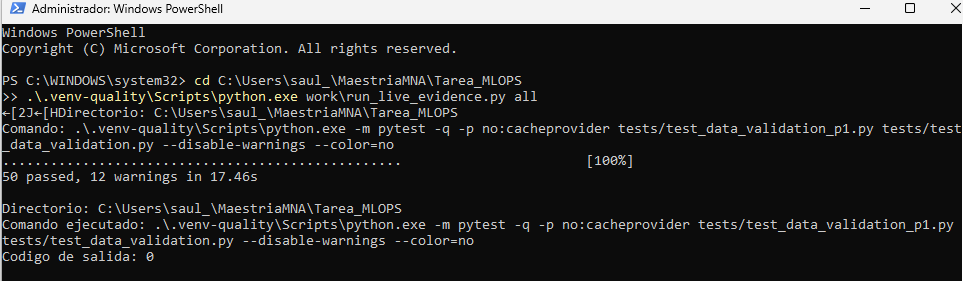

# Actividad 7 - Calidad y reproducibilidad P1

## 1. Alcance

La contribución de Saúl complementa los controles de Daniel y Diego con la entrada real de P1:
panel estación-hora, objetivo `departures` y las siete variables utilizadas por los modelos de demanda.
Se agrega `mibici_ml/data_validation_p1.py`, sus constantes en `config.py` y
`tests/test_data_validation_p1.py`. Se reutilizan la ingesta, las transformaciones y las pruebas
de causalidad existentes; no se reentrenan los modelos de demanda ni se modifica el Model Registry.
DeepChecks puede ajustar estimadores internos para sus chequeos de drift.

Los comandos y resultados de las otras contribuciones permanecen en sus carpetas. Este apartado
conserva salidas P1 independientes y no declara resueltos los pendientes de seguridad o de P2/P3.

## 2. Comandos reproducibles

Requisito: ejecutar previamente la ingesta del README raíz. En PowerShell, desde la raíz del repositorio:

```powershell
py -3.12 -m venv .venv-quality
.\.venv-quality\Scripts\python.exe -m pip install -r requirements-quality.txt
.\.venv-quality\Scripts\python.exe -m pip check
.\.venv-quality\Scripts\python.exe -m pytest -q tests/test_data_validation_p1.py tests/test_data_validation.py
.\.venv-quality\Scripts\python.exe -m mibici_ml.data_validation_p1
```

En Linux/macOS, sustituir `.venv-quality\Scripts\python.exe` por `.venv-quality/bin/python`.
Los targets equivalentes son `make data-validation-p1-tests` (solo las pruebas nuevas) y
`make data-validation-p1`. GNU Make permite sobrescribir `QUALITY_PYTHON` en Windows.

En el entorno principal de entrenamiento, ejecutar las pruebas existentes de causalidad/reproducibilidad:

```bash
python -m pytest -q tests/test_p1_model.py -k future_trip_changes
```

El comando de calidad acepta `--processed-dir`, `--manifest-path`, `--output-dir`, `--summary-path`,
`--sample-size` y `--seed`. Sus valores por defecto provienen de `config.py`. No necesita servidor
MLflow ni acceso a Internet durante la validación. No se modifica `requirements.txt` ni el lock de P1.

## 3. Datos y procedencia de esta ejecución

- Ejecución local: **1 de noviembre de 2026**; base `main` **`b545c9d4509a938bfba58f413582a187c6cab4b4`**.
- Rama local: `feat/p1-quality-actividad7`; cambios sin commit ni push al generar esta evidencia.
  `git_dirty=true` identifica honestamente este estado. El commit base no contiene por sí solo
  la implementación nueva; el JSON incluye los hashes de los archivos ejecutados.
- Datos: 12 meses, octubre de 2025 a septiembre de 2026. Versión
  `0f000bd5e6563196d7c1133e119024e4e864f6325752e4f6b48e40011895d1a3`.
- Se verificaron la identidad del manifiesto, el rango, los meses y los hashes de todos los Parquet
  de viajes y del catálogo. Un cambio del catálogo no se acepta silenciosamente.
- Entorno de calidad: Python 3.12.14, DeepChecks 0.19.1, NumPy 1.26.4, pandas 2.2.3,
  scikit-learn 1.5.2 y PyArrow 24.0.0. `pip check` no detectó dependencias incompatibles.
- Entorno de entrenamiento para las pruebas existentes: Python 3.12.14, NumPy 2.5.4,
  pandas 3.0.6, scikit-learn 1.9.1 y MLflow 3.17.1. Los entornos permanecen separados.

## 4. Cobertura de las pruebas

Las **33 pruebas nuevas** cubren casos normales, límites y errores sobre el contrato de P1:

| Área | Casos comprobados |
|---|---|
| Panel | Claves estación-hora únicas, horas continuas y exactas, emisión a medianoche y metadatos coherentes |
| Objetivo | Cero válido; negativos, fracciones, nulos e infinitos rechazados |
| Historia | Faltantes esperados por arranque separados de corrupción en una fila elegible; máscaras falsas rechazadas |
| Predictores | Las siete variables del modelo, numéricas y finitas; calendario correcto; etiquetas, estación y fecha excluidas |
| Particiones | Límites completos de train/val/test, sin traslape; muestras acotadas y repetibles |
| Versionado | Catálogo alterado y manifiesto adulterado rechazados antes de reconstruir el panel |
| DeepChecks | Regresión explícita para conteos, nulos y drift inducidos detectados, errores técnicos conservados |
| Salidas | Resumen agregado, HTML fuera del repositorio admitido y diagnóstico conservado ante error técnico |

La ejecución conjunta con las **17 pruebas existentes de DeepChecks** dio **50 passed, 12 warnings**,
sin omisiones ni fallos. Los avisos corresponden a APIs de NumPy/pandas utilizadas por DeepChecks.

La prueba existente `test_future_trip_changes_do_not_change_day_ahead_features_or_predictions`
se ejecutó para Ridge, HistGB Poisson e HistGB cuadrático: **3 passed, 17 deselected**. Modifica
viajes futuros, comprueba que entradas y entrenamiento previos permanecen iguales y vuelve a ajustar
los modelos con la misma semilla para exigir predicciones idénticas. Esto respalda causalidad y
reproducibilidad; no es una prueba nueva añadida solo para aumentar el conteo.

También se ejecutó la regresión de ingesta, variables y modelos de las tres preguntas:

```bash
python -m pytest -q tests --ignore=tests/test_repository_security.py --color=no -p no:cacheprovider
```

Resultado: **215 passed, 11 skipped, 42 warnings**, sin fallos. Las 11 omisiones corresponden a las
8 pruebas existentes y las 3 nuevas que necesitan DeepChecks; todas pasaron en el entorno de calidad.
Este comando excluye explícitamente las 11 pruebas de seguridad y **no se presenta como suite completa**.
La revisión adicional de seguridad en Windows dio **6 passed, 5 failed**: dos aserciones POSIX
incompatibles y tres fallos de rutas al invocar Bash. No se cambian ni se ocultan esos pendientes
de los controles existentes en esta aportación P1.
Ruff y `git diff --check` también terminaron correctamente.

El gate `python -m bandit -r mibici_ml -ll -ii` con Bandit 1.9.4 terminó con código 0 y ningún
hallazgo medio/alto; el inventario conserva 16 avisos de severidad baja. Esto no sustituye la
auditoría de dependencias ni resuelve los hallazgos previamente documentados por el equipo.
Los tres avisos bajos añadidos por el módulo P1 corresponden a la consulta de procedencia con Git:
uso de `subprocess`, búsqueda del ejecutable en `PATH` y llamada al proceso. Sus argumentos son
constantes y no se utiliza `shell=True`; los avisos se conservan para revisión.
Las cuatro pruebas de higiene se repitieron con los ocho archivos de esta aportación agregados
al índice de Git: **4 passed, 7 deselected**, sin archivos sensibles ni secretos evidentes detectados.

## 5. Resultados sobre datos reales

El panel completo tiene **4,125,960 filas y 471 estaciones**. Hay 683,352 filas anteriores al
conocimiento de la estación y 316,296 filas conocidas con historia insuficiente. La cohorte final
tiene **3,126,312 filas**, sin claves estación-hora duplicadas, objetivos inválidos ni predictores
no finitos. Estos controles estructurales se ejecutan sobre todo el panel, antes del muestreo.

| Partición | Filas elegibles | Ventana de la cohorte |
|---|---:|---|
| Entrenamiento | 2,160,408 | 30/oct/2025 a 30/jun/2026 |
| Validación | 629,424 | 1/jul/2026 a 31/ago/2026 |
| Prueba | 336,480 | 1/sep/2026 a 30/sep/2026 |

El entrenamiento configurado inicia el 1/oct/2025; la cohorte elegible empieza después del periodo
necesario para disponer de cuatro semanas de historia. Los conteos coinciden con la evidencia
histórica de P1 en `reports/tables/p1_quality.json`, aun usando el entorno de calidad separado.

Se entregan muestras de hasta **150,000 filas por conjunto**, semilla **42**, a las suites.
Los chequeos individuales aplican sus límites internos de DeepChecks 0.19.1: Feature/Label Drift
usan hasta 100,000 filas, Multivariate Drift hasta 10,000 y Outlier Sample Detection hasta 5,000.
Data Duplicates y Samples Mix sí utilizan aquí las 150,000 filas de sus conjuntos.

| Suite | Total | Aprobados | Fallidos | Sin condiciones | No aplicables | Errores |
|---|---:|---:|---:|---:|---:|---:|
| `p1_integridad` | 13 | 10 | 1 | 1 | 1 | 0 |
| `p1_train_val` | 12 | 9 | 1 | 0 | 2 | 0 |
| `p1_train_test` | 12 | 9 | 1 | 0 | 2 | 0 |
| **Total** | **37** | **28** | **3** | **1** | **5** | **0** |

Interpretación de hallazgos:

- **Data Duplicates: 25.39%** en el chequeo de integridad. Esta versión compara las columnas del marco,
  incluidos objetivo y fecha, sin el identificador de estación: distintas estaciones pueden compartir
  esas variables a la misma hora. No son claves estación-hora duplicadas. El conteo completo independiente
  encontró 2,564,986 vectores de predictores repetidos; usa otro universo y otra definición y no debe
  confundirse con el porcentaje de la muestra. P1 no usa estación ni fecha absoluta como predictores,
  de modo que diferentes estaciones/horas pueden compartir calendario y rezagos, incluidos ceros.
  No se eliminan estas observaciones ni se cambia la cohorte para hacer pasar el chequeo.
- **Train Test Samples Mix: 58.3%** entre entrenamiento-validación y **56.25%** entre entrenamiento-prueba.
  Compara las siete variables y el objetivo, excluyendo la fecha. Mide coincidencias de perfiles y
  resultados entre muestras. Se conserva como hallazgo y se interpreta junto con
  las claves únicas, ventanas sin traslape y pruebas de causalidad. Por sí solo no demuestra ni descarta
  una fuga de información.
- Los chequeos de drift de variables, multivariado y etiqueta aprobaron. Esto significa que **no
  detectaron drift con estas muestras, umbrales y versión**, no que se haya demostrado su ausencia.
- Los chequeos exclusivos de clasificación y el que requiere un índice no declarado se registran
  como **no aplicables**, con su motivo. `Outlier Sample Detection` es **sin condiciones**, no un aprobado.

El comando terminó con **código 0** porque no hubo errores estructurales ni técnicos. Los tres
hallazgos estadísticos permanecen visibles. Los errores técnicos, identidades alteradas o contratos
inválidos sí producen una salida distinta de cero.

Resumen versionable: [`p1_data_validation_summary.json`](../../../reports/tables/p1_data_validation_summary.json).
Los HTML `reports/data_validation/p1_*.html` quedan locales e ignorados porque pueden incluir ejemplos.

## 6. Capturas de terminal

La primera captura corresponde a la ejecución en Windows PowerShell del 1 de noviembre de 2026:
**50 passed, 12 warnings en 17.46 s**, con código de salida **0**. La imagen se conserva tal como
fue capturada en la máquina del autor de esa aportación. Las otras tres capturas siguen pendientes
de incorporar; el registro de la ejecución no se versiona.

Esta captura acredita la ejecución de PyTest sobre funciones de calidad de datos, con casos
normales y límite descritos en el apartado 4. El muestreo repetible incluido en estas pruebas
no sustituye la reproducibilidad del entrenamiento, que corresponde a la segunda captura.
La validación DeepChecks del conjunto real corresponde a la tercera captura.

| Archivo | Estado | Evidencia |
|---|---|---|
| [01_pytest_calidad_p1.png](./01_pytest_calidad_p1.png) | Incorporada | Comando y resultado de las 33 pruebas nuevas más las 17 existentes: 50 aprobadas |
| `02_p1_causalidad_reproducibilidad.png` | Pendiente | Comando y resultado de causalidad y repetición del ajuste en los tres candidatos de P1 |
| `03_deepchecks_p1_datos_reales.png` | Pendiente | Comando, cohorte, versión de datos y resultados de las tres suites, incluidos sus hallazgos |
| `04_regresion_p1_p2_p3.png` | Pendiente | Comando y resultado de regresión de ingesta y modelos, con la exclusión de seguridad visible |



Desde `C:\Users\saul_\MaestriaMNA\Tarea_MLOPS`, ejecutar cada comando y capturar la terminal cuando
termine. Los dos controles de calidad utilizan el entorno aislado:

```powershell
.\.venv-quality\Scripts\python.exe -m pytest -q -p no:cacheprovider tests/test_data_validation_p1.py tests/test_data_validation.py --disable-warnings --color=no
```

```powershell
.\.venv-quality\Scripts\python.exe -m mibici_ml.data_validation_p1
```

Para causalidad y regresión, `python` debe corresponder al entorno principal de entrenamiento
indicado en el apartado 3:

```powershell
python -m pytest -q -p no:cacheprovider tests/test_p1_model.py -k future_trip_changes --disable-warnings --color=no
```

```powershell
python -m pytest -q tests --ignore=tests/test_repository_security.py -p no:cacheprovider --disable-warnings --color=no
```

`--disable-warnings` reduce el detalle de los avisos en pantalla; PyTest conserva su conteo en
el resumen. El último comando excluye las pruebas de seguridad y no acredita la suite completa.
Guardar las capturas en esta carpeta conservando visibles el directorio, el comando y el resultado.

## 7. Límites de esta aportación

- No modifica modelos, métricas ni decisiones de selección de las entregas anteriores.
- No corrige los problemas previos de seguridad en Windows ni la causalidad del inventario de P2;
  no debe usarse esta evidencia para declarar cerrados esos pendientes del equipo.
- No cambia los README de evidencia ni las capturas de Daniel y Diego.
- La integración de esta aportación se realiza mediante Pull Request. La aprobación de otro integrante
  y la incorporación de las tres capturas pendientes deben verificarse antes de declarar cerrada la entrega.
