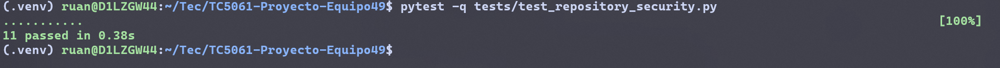
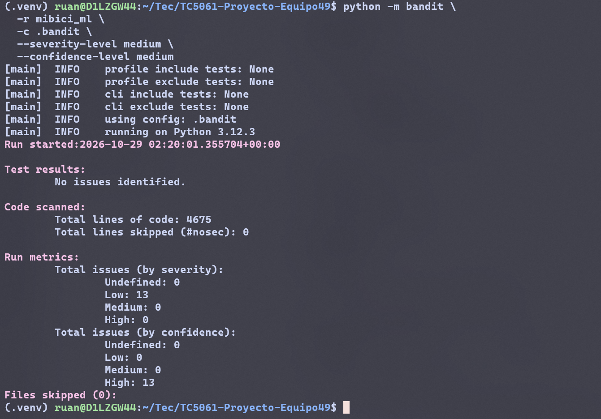
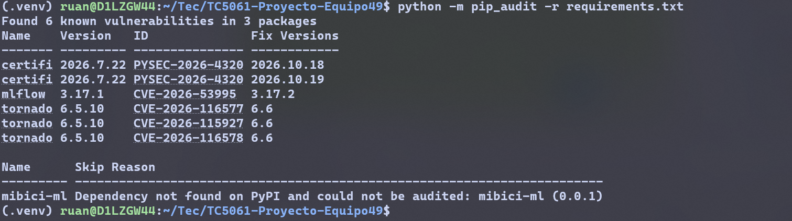
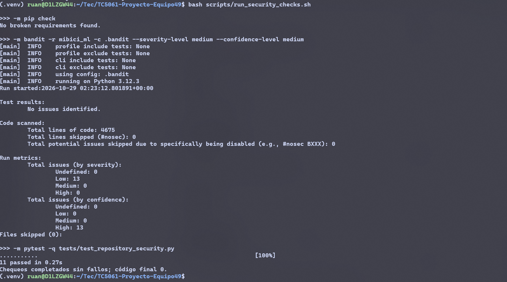
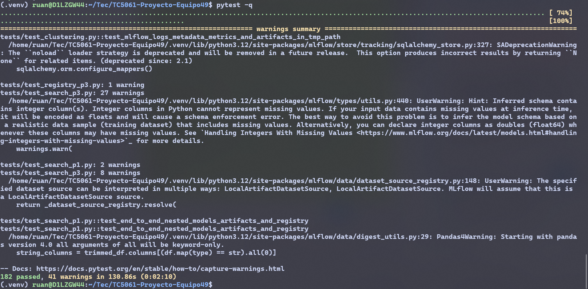
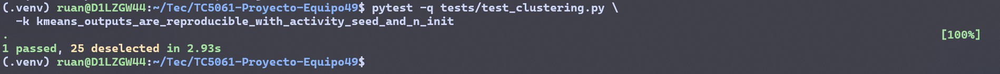

# Actividad 7 - Evidencia de tests y chequeos de seguridad

## 1. Alcance

La contribución de Daniel integra chequeos básicos de seguridad y calidad:

- análisis estático con Bandit;
- auditoría de dependencias con pip-audit;
- pruebas PyTest de higiene del repositorio;
- controles de archivos sensibles y patrones evidentes de secretos;
- reglas de `.gitignore` para proteger archivos sensibles y reportes temporales;
- script reproducible con modo offline y modo de auditoría;
- targets `security` y `security-audit` en Makefile;
- corrección del hallazgo B108 en el destino temporal de entrenamiento;
- prueba focalizada de reproducibilidad para P3 con semilla y `n_init` definidos.

DeepChecks pertenece a otra contribución del equipo y no se implementó aquí.

## 2. Resultados verificados

| Control | Resultado |
|---|---|
| Pruebas de higiene y seguridad | **11 passed**, cero fallos |
| Reproducibilidad P3 focalizada | **1 passed**; seed 42 y `n_init=10` |
| Suite completa | **182 passed, 41 warnings**, cero fallos |
| Bandit medium/high | **0 hallazgos**; gate medium/medium con código 0 |
| Bandit low | **13 avisos informativos** |
| `pip check` | **No broken requirements found** |
| Ruff | **All checks passed** |
| pip-audit | **6 registros en 3 paquetes**; hallazgos conservados y documentados |

Los warnings de la suite completa son avisos de SQLAlchemy, MLflow y Pandas; no representan tests
fallidos. El análisis Bandit amplio reporta los avisos low por separado; el gate medium/medium está
limpio.

## 3. Corrección B108

Antes del cambio, `/tmp/mibici-runs` era un destino compartido para las salidas por defecto de P2/P3.
Bandit lo clasificó como B108 medium. Ahora cada ejecución P2/P3 crea un directorio único y privado
mediante `tempfile.mkdtemp()`, bajo una base portable derivada de `tempfile.gettempdir()`.
`MLFLOW_TRAIN_OUTPUT_DIR` permite configurar la carpeta base; `--output-dir` explícito se respeta.
P1 conserva su comportamiento y no se crean carpetas al importar la configuración. Las pruebas
verifican unicidad, configuración y ausencia de efectos de import. El gate Bandit medium/medium queda
en cero.

## 4. Resultado pip-audit

pip-audit completó la consulta y devolvió código 1 por hallazgos conocidos; esto no representa un
fallo de red o de ejecución.

| Paquete | Versión detectada | ID | Versión corregida reportada | Estado |
|---|---:|---|---|---|
| certifi | 2026.7.22 | `PYSEC-2026-4320` | 2026.10.18 / 2026.10.19 | Pendiente de evaluación coordinada; preferir evaluar 2026.10.19 o posterior |
| mlflow | 3.17.1 | `CVE-2026-53995` | 3.17.2 | Pendiente de evaluación coordinada |
| tornado | 6.5.10 | `CVE-2026-116577` | 6.6 | Pendiente de evaluación coordinada |
| tornado | 6.5.10 | `CVE-2026-115927` | 6.6 | Pendiente de evaluación coordinada |
| tornado | 6.5.10 | `CVE-2026-116578` | 6.6 | Pendiente de evaluación coordinada |

pip-audit presentó dos filas de corrección para el mismo paquete e ID de certifi; se documentan como
un hallazgo, no como dos vulnerabilidades distintas. No se usó `--fix` ni se actualizaron dependencias
productivas. Los tres paquetes aparecen fijados directamente en `requirements.txt`; sus actualizaciones
requieren un cambio coordinado y regresión completa. `mibici-ml==0.0.1` es un paquete local no
publicado en PyPI, por lo que pip-audit lo omitió. Esa omisión no es una vulnerabilidad.

## 5. Evidencias

| Archivo | Comando mostrado | Resultado visible | Criterio |
|---|---|---|---|
| [01_pytest_security.png](./01_pytest_security.png) | `pytest -q tests/test_repository_security.py` | 11 passed, cero fallos | Pruebas automatizadas de seguridad e higiene |
| [02_bandit_gate.png](./02_bandit_gate.png) | `python -m bandit -r mibici_ml -c .bandit --severity-level medium --confidence-level medium` | Gate exitoso; 0 medium/high | Análisis estático |
| [03_pip_audit.png](./03_pip_audit.png) | `python -m pip_audit -r requirements.txt` | 6 registros en certifi, MLflow y Tornado; paquete local omitido | Auditoría de dependencias |
| [04_security_script.png](./04_security_script.png) | `bash scripts/run_security_checks.sh` | `pip check`, Bandit y PyTest correctos; código final 0 | Automatización reproducible |
| [05_pytest_full.png](./05_pytest_full.png) | `pytest -q` | 182 passed, 41 warnings, cero fallos | Regresión completa |
| [07_p3_reproducibility.png](./07_p3_reproducibility.png) | `pytest -q tests/test_clustering.py -k kmeans_outputs_are_reproducible_with_activity_seed_and_n_init` | 1 passed; el README explica seed 42 y `n_init=10` | Reproducibilidad P3 |

## 6. Capturas y pies de figura

### Pruebas de seguridad



**Figura 1.** Ejecución de las pruebas PyTest de higiene del repositorio, que verifican archivos
sensibles, patrones de secretos, reglas de `.gitignore` y comportamiento del script de seguridad.

### Gate Bandit



**Figura 2.** Gate Bandit aplicado al código productivo con severidad y confianza mínimas medias, sin
hallazgos medios o altos.

### Auditoría de dependencias



**Figura 3.** Auditoría de dependencias con pip-audit; muestra vulnerabilidades y versiones de
corrección documentadas para evaluación coordinada.

### Script offline



**Figura 4.** Ejecución del script offline de seguridad, que integra `pip check`, Bandit y las pruebas
PyTest de higiene.

### Suite completa



**Figura 5.** Regresión completa del proyecto después de integrar los controles de seguridad.

### Reproducibilidad P3



**Figura 6.** Prueba focalizada de reproducibilidad de P3 con semilla 42 y `n_init=10`.

## 7. Comandos reproducibles

Instala las herramientas de seguridad en el entorno virtual del repositorio:

```bash
python -m pip install -r requirements-security.txt
```

Ejecuta los controles offline, la auditoría con hallazgos y las pruebas:

```bash
bash scripts/run_security_checks.sh
bash scripts/run_security_checks.sh --with-audit
pytest -q tests/test_repository_security.py
pytest -q
ruff check .
```

Los targets equivalentes requieren GNU Make:

```bash
make security
make security-audit
```

GNU Make no estaba instalado en el entorno de esta ejecución. Se validó la indentación del Makefile y
se ejecutaron directamente los scripts Bash.

## 8. Interpretación

El gate offline pasa. pip-audit operó correctamente y conservó sus hallazgos; no se afirma que la
auditoría esté limpia ni que todas las dependencias estén libres de vulnerabilidades. La evidencia
respalda las pruebas PyTest, los chequeos básicos de seguridad, la corrección B108 y la documentación
de los resultados. DeepChecks pertenece a otra contribución del equipo.

## 9. Limitaciones y pendientes

- Permanecen 13 avisos Bandit low sobre `subprocess` y resolución de Git mediante `PATH` (B607).
- Algunas consultas de metadatos Git en `demand.py` y `risk.py` no definen timeout explícito.
- Las vulnerabilidades de certifi, MLflow y Tornado requieren actualización coordinada y validación
  completa; no se usó `--fix`.
- `make security` y `make security-audit` no se ejecutaron localmente porque GNU Make no estaba
  instalado; sí se ejecutaron los scripts equivalentes.
- Una integración CI futura puede automatizar estos controles.
