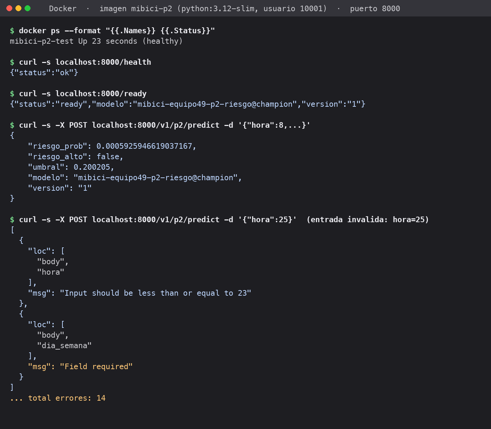

# Actividad 8: evidencia de la API P2 en contenedor

Evidencia de que la API de P2 responde desde el contenedor en ejecución.



Captura generada a partir de la salida real de los comandos siguientes, ejecutados contra la imagen `mibici-p2` (corriendo con Docker 29.8, usuario 10001):

```bash
docker run -d --name mibici-p2-test -p 8000:8000 mibici-p2:latest
docker ps --format "{{.Names}} {{.Status}}"
curl -s localhost:8000/health
curl -s localhost:8000/ready
curl -s -X POST localhost:8000/v1/p2/predict -H "Content-Type: application/json" \
  -d '{"hora":8,"dia_semana":2,"fin_de_semana":0,"capacidad":30,"flujo_acumulado":-4,"flujo_acumulado_sobre_c":-0.1333,"llegadas_1h":3,"salidas_1h":7,"llegadas_2h":5,"salidas_2h":12,"salidas_misma_hora_ayer":9,"riesgo_observado_h":0,"riesgo_observado_previo_h":0,"tendencia_flujo_3h":-0.2}'
curl -s -X POST localhost:8000/v1/p2/predict -H "Content-Type: application/json" -d '{"hora":25}'
```

Transcripción textual (la misma salida que la imagen):

```text
$ docker ps --format "{{.Names}} {{.Status}}"
mibici-p2-test Up 23 seconds (healthy)

$ curl -s localhost:8000/health
{"status":"ok"}

$ curl -s localhost:8000/ready
{"status":"ready","modelo":"mibici-equipo49-p2-riesgo@champion","version":"1"}

$ curl -s -X POST localhost:8000/v1/p2/predict -d '{"hora":8,...}'
{
    "riesgo_prob": 0.0005925946619037167,
    "riesgo_alto": false,
    "umbral": 0.200205,
    "modelo": "mibici-equipo49-p2-riesgo@champion",
    "version": "1"
}

$ curl -s -X POST localhost:8000/v1/p2/predict -d '{"hora":25}'  (entrada invalida: hora=25)
[
  {"loc": ["body", "hora"], "msg": "Input should be less than or equal to 23"},
  {"loc": ["body", "dia_semana"], "msg": "Field required"}
]
... total errores: 14
```

Notas:

- La captura es una representación de la terminal con el texto real, no una captura directa de pantalla.
- Los `riesgo_prob` coinciden con los del modelo local, lo que confirma que el bundle empaquetado reproduce el champion.
- Las pruebas automáticas de la API están en `tests/test_serving_p2.py` y `tests/test_serving_contract.py`.
