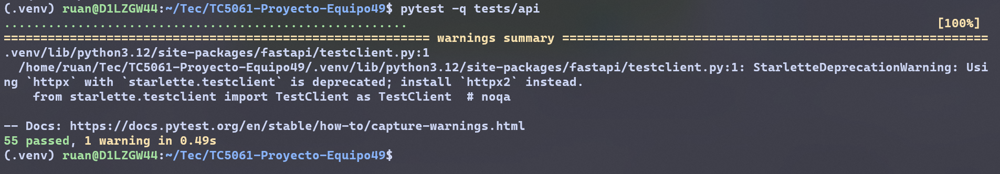
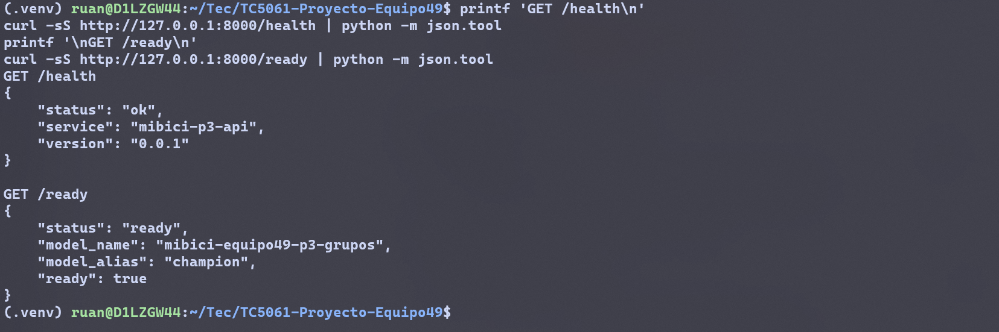
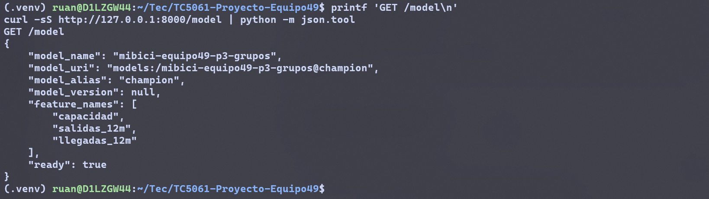
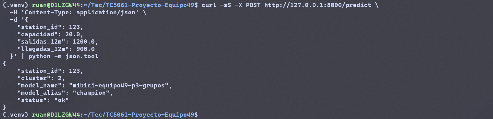
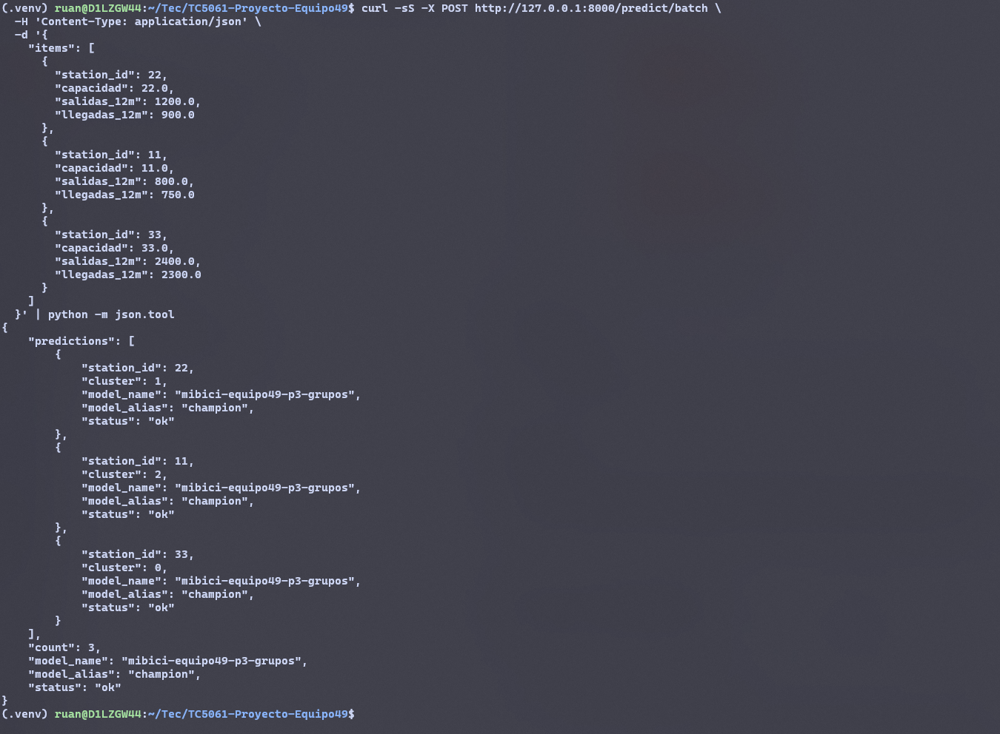
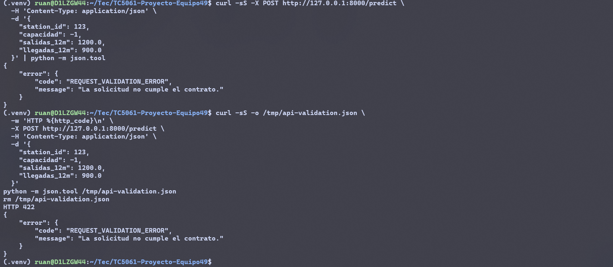
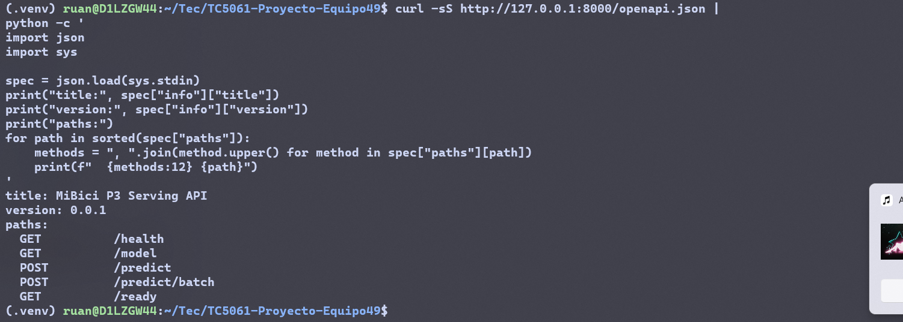

# Actividad 8 - API REST P3 con FastAPI

## 1. Alcance implementado

Se implementó la API REST de P3 con FastAPI y Pydantic, el protocolo de provider inyectable, respuestas y errores seguros, pruebas deterministas y ejecución local con Uvicorn. El provider fake se activa explícitamente para desarrollo; no se presenta como el modelo real.

## 2. Arquitectura

`mibici_ml.api.app.create_app(provider=...)` recibe el `ModelProvider`. La API valida las entradas, forma un DataFrame con las features en orden y delega la inferencia. `station_id` sirve solo para correlación y no se envía al provider. La instancia predeterminada no usa fake ni conecta con MLflow; health está disponible y readiness devuelve 503.

Con `MIBICI_API_PROVIDER=mlflow`, la factory devuelve `UnconfiguredModelProvider`: la carga falla de forma controlada, `/health` sigue disponible y `/ready` devuelve 503. Este modo no conecta al Registry ni cambia a fake.

## 3. Contrato P3

- Nombre: `mibici-equipo49-p3-grupos`
- Alias: `champion`
- URI: `models:/mibici-equipo49-p3-grupos@champion`
- Features, en orden: `capacidad`, `salidas_12m`, `llegadas_12m`
- Output: `cluster` entero no negativo
- `station_id`: opcional, entero o string no vacío

## 4. Endpoints

| Endpoint | Comportamiento |
|---|---|
| `GET /health` | 200 mientras el proceso esté activo; no representa readiness |
| `GET /ready` | 200 si el provider está listo; 503 en caso contrario |
| `GET /model` | Metadata contractual y segura; 503 si no está listo |
| `POST /predict` | Predicción individual P3 |
| `POST /predict/batch` | Predicciones ordenadas, 1–100 items por defecto |
| `GET /openapi.json` | Especificación OpenAPI generada por FastAPI |

## 5. Validaciones Pydantic

Los schemas rechazan campos extra, valores booleanos usados como números, números negativos o no finitos, tipos inválidos, campos faltantes, `station_id` string vacío y lotes vacíos o mayores de 100. Se aceptan enteros y floats JSON normales. Las etiquetas se validan y convierten a `int` nativo.

## 6. ModelProvider

El protocolo define `load()`, `is_ready()`, `predict(frame)` y `metadata()`. `predict` devuelve una secuencia unidimensional de etiquetas enteras. La frontera exige que una implementación de provider normalice un ndarray 1D o una Series a `list[int]`; de un DataFrame debe extraer la única columna de cluster y convertirla a `list[int]`. Matrices multidimensionales y DataFrames con varias columnas se rechazan.

`FakeModelProvider` es determinista, no accede a red, no lee datos ni guarda artefactos. Se usa en pruebas y en `mibici_ml.api.dev:app`, un entrypoint de desarrollo explícito. No sustituye al champion.

## 7. Manejo de errores

Las respuestas de error usan `{"error":{"code":"...","message":"..."}}`. Un body inválido produce 422, un provider no listo o una carga fallida produce 503 y un error de inferencia/salida produce 500. Los mensajes no exponen inputs, rutas, URI de tracking ni stack traces.

## 8. Pruebas y controles

- `./.venv/bin/pytest -q tests/api`: 55 passed.
- `./.venv/bin/pytest -q`: 281 passed, 11 skipped.
- Ruff: pasó `ruff check .` y el chequeo focalizado de `tests/api`.
- `./.venv/bin/python -m pip check`: sin dependencias rotas.
- `bash scripts/run_security_checks.sh`: pasó; Bandit reportó cero hallazgos medium/high y los 11 tests de higiene pasaron.
- TestClient emitió una advertencia deprecada asociada a la combinación instalada de Starlette y HTTPX. La advertencia no afectó las pruebas y no se modificaron dependencias en esta rama.

## 9. Ejemplo de uso

Desde la raíz, el entrypoint explícito de desarrollo se ejecuta con:

```bash
./.venv/bin/uvicorn mibici_ml.api.dev:app --host 127.0.0.1 --port 8000
```

Request individual:

```json
{
  "station_id": 123,
  "capacidad": 20.0,
  "salidas_12m": 1200.0,
  "llegadas_12m": 900.0
}
```

Respuesta observada con el fake: `{"station_id":123,"cluster":2,"model_name":"mibici-equipo49-p3-grupos","model_alias":"champion","status":"ok"}`. El cluster es una salida determinista de desarrollo, no una predicción del champion real.

## 10. Evidencia de ejecución

Se inspeccionaron visualmente las siete capturas. Los comandos, dimensiones y resultados visibles son:

| Figura | Archivo | Comando ejecutado | Resultado demostrado |
|---|---|---|---|
| 1 | `01_pytest_api.png` | `pytest -q tests/api` | 55 passed |
| 2 | `02_health_ready.png` | `printf 'GET /health\n'`<br>`curl -sS http://127.0.0.1:8000/health \| python -m json.tool`<br>`printf '\nGET /ready\n'`<br>`curl -sS http://127.0.0.1:8000/ready \| python -m json.tool` | Health OK y readiness ready con alias `champion`; HTTP 200 |
| 3 | `03_model_metadata.png` | `printf 'GET /model\n'`<br>`curl -sS http://127.0.0.1:8000/model \| python -m json.tool` | Nombre, URI de alias, versión nula, features y readiness |
| 4 | `04_predict.png` | <code>curl -sS -X POST http://127.0.0.1:8000/predict \</code><br><code>-H 'Content-Type: application/json' \</code><br><code>-d '{</code><br><code>&nbsp;&nbsp;"station_id": 123,</code><br><code>&nbsp;&nbsp;"capacidad": 20.0,</code><br><code>&nbsp;&nbsp;"salidas_12m": 1200.0,</code><br><code>&nbsp;&nbsp;"llegadas_12m": 900.0</code><br><code>}' \| python -m json.tool</code> | Request individual con `station_id: 123`; respuesta con `cluster: 2` del fake |
| 5 | `05_batch.png` | <code>curl -sS -X POST http://127.0.0.1:8000/predict/batch \</code><br><code>-H 'Content-Type: application/json' \</code><br><code>-d '{</code><br><code>&nbsp;&nbsp;"items": [</code><br><code>&nbsp;&nbsp;&nbsp;&nbsp;{"station_id": 22, "capacidad": 22.0, "salidas_12m": 1200.0, "llegadas_12m": 900.0},</code><br><code>&nbsp;&nbsp;&nbsp;&nbsp;{"station_id": 11, "capacidad": 11.0, "salidas_12m": 800.0, "llegadas_12m": 750.0},</code><br><code>&nbsp;&nbsp;&nbsp;&nbsp;{"station_id": 33, "capacidad": 33.0, "salidas_12m": 2400.0, "llegadas_12m": 2300.0}</code><br><code>&nbsp;&nbsp;]</code><br><code>}' \| python -m json.tool</code> | Tres respuestas en orden de entrada y `count: 3` |
| 6 | `06_validation_error.png` | <code>curl -sS -X POST http://127.0.0.1:8000/predict \</code><br><code>-H 'Content-Type: application/json' \</code><br><code>-d '{</code><br><code>&nbsp;&nbsp;"station_id": 123,</code><br><code>&nbsp;&nbsp;"capacidad": -1,</code><br><code>&nbsp;&nbsp;"salidas_12m": 1200.0,</code><br><code>&nbsp;&nbsp;"llegadas_12m": 900.0</code><br><code>}' \| python -m json.tool</code><br><code>curl -sS -o /tmp/api-validation.json \</code><br><code>-w 'HTTP %{http_code}\n' \</code><br><code>-X POST http://127.0.0.1:8000/predict \</code><br><code>-H 'Content-Type: application/json' \</code><br><code>-d '{</code><br><code>&nbsp;&nbsp;"station_id":123,</code><br><code>&nbsp;&nbsp;"capacidad":-1,</code><br><code>&nbsp;&nbsp;"salidas_12m":1200.0,</code><br><code>&nbsp;&nbsp;"llegadas_12m":900.0</code><br><code>}'</code><br><code>python -m json.tool /tmp/api-validation.json</code><br><code>rm /tmp/api-validation.json</code> | Capacidad negativa rechazada con HTTP 422 y error genérico |
| 7 | `07_openapi.png` | <code>curl -sS http://127.0.0.1:8000/openapi.json \| python -c '</code><br><code>import json</code><br><code>import sys</code><br><code>spec = json.load(sys.stdin)</code><br><code>print("title:", spec["info"]["title"])</code><br><code>print("version:", spec["info"]["version"])</code><br><code>print("paths:")</code><br><code>for path in sorted(spec["paths"]):</code><br><code>&nbsp;&nbsp;&nbsp;&nbsp;methods = ", ".join(method.upper() for method in spec["paths"][path])</code><br><code>&nbsp;&nbsp;&nbsp;&nbsp;print(f"  {methods:12} {path}")</code><br><code>'</code> | Título y versión del servicio; rutas health, ready, model, predict y batch |

Las siete capturas fueron revisadas visualmente. Son legibles y no muestran credenciales, tokens ni información sensible. Los identificadores utilizados son ejemplos y las predicciones corresponden al FakeModelProvider.

## 11. Figuras



Figura 1. Ejecución de las 55 pruebas automatizadas de la API P3, que cubren endpoints, esquemas Pydantic, readiness, metadata, predicción individual y batch, validación y manejo seguro de errores.



Figura 2. Verificación local de salud y disponibilidad con el provider explícito de desarrollo.



Figura 3. Metadata contractual de P3: nombre, alias, features y estado del provider.



Figura 4. Petición individual a `/predict`; se preserva `station_id` y el cluster entero lo genera FakeModelProvider.



Figura 5. Predicción batch con orden de entrada, identificadores y conteo preservados.



Figura 6. Validación Pydantic de capacidad negativa con HTTP 422 y sin detalles internos.



Figura 7. Especificación OpenAPI generada por FastAPI con las rutas publicadas por la API P3.

## 12. Alcance verificado

Las pruebas locales no contactaron el Model Registry ni cargaron un modelo serializado. No se ejecutó ni se construyó un contenedor. La app predeterminada no selecciona el provider fake; el entrypoint fake se utiliza solo de forma explícita para desarrollo y pruebas.
