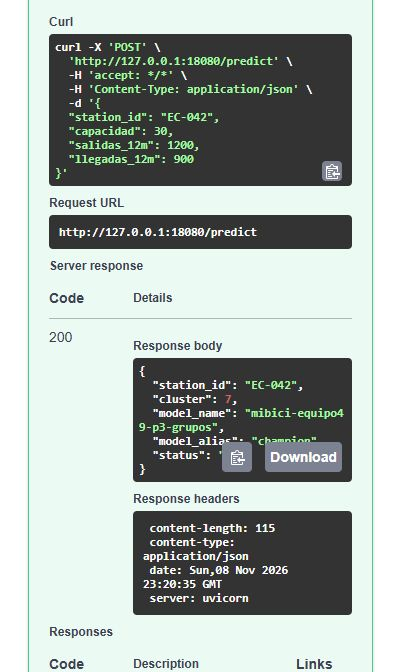

# Actividad 8 - Verificación con Podman

Saúl Salgado · 8 de noviembre de 2026 · base `main` en `8eb3a056caea7d463328b8604edb0aa31dd74b0f`.

Swagger UI envió un `POST /predict` al contenedor `mibici-podman-act8`, publicado en
`127.0.0.1:18080`. Para `EC-042` con capacidad 30, 1,200 salidas y 900 llegadas, el
modelo P3 respondió HTTP 200 con el clúster **7**. El campo `model_alias` identifica a `champion`.



La [transcripción](./02_verificacion_podman.txt) incluye el contenedor, la imagen, el usuario de
ejecución, los metadatos y las peticiones HTTP. Los [comandos de reproducción](../../../../README.md#prueba-local-con-podman)
están en el README del proyecto.

## Modelos utilizados

Esta corrida reconstruyó los dos candidatos del equipo con el código de `main` y los registró en
dos bases SQLite privadas. Cada exportación salió de su propio `champion` local. Los identificadores
siguientes permiten distinguir estas versiones de las usadas para la evidencia Docker de Diego.

| Modelo local | Insumos y procedimiento | Comprobación de paridad |
|---|---|---|
| `mibici-equipo49-p3-grupos@champion` v1, run `f3c43ec6dd6748f2bc90a81a55d47998` | `search_p3` sobre `reports/tables/estaciones_resumen.csv`, semilla 42, `n_init=10`, KMeans con `k=8`. SHA-256 del CSV `0b1169a7d52c23048b5b6f6e2ba47be2cfdad8597129709e94b6670984aa69bf`. | Las predicciones del modelo exportado y del Registry coincidieron para las 484 estaciones. |
| `mibici-equipo49-p2-riesgo@champion` v1, run `6a83b43bc8504df08e998d82bbcade81` | `hist_gb`, variables v2, semilla 42, `learning_rate=0.03`, `max_iter=600`, `max_leaf_nodes=15`, `min_samples_leaf=100`. Umbral elegido sobre validación `0.2002045660284505`. | Se compararon el estimador ajustado, la versión registrada, el alias y el bundle skops. Para el ejemplo documentado, la API devuelve `0.0005925946619037167` y `riesgo_alto=false`. |

Los 12 Parquet de viajes de P2 coinciden con `main`. El catálogo local de estaciones corresponde al
manifiesto versionado en `ad87480:references/data_manifest.json`. Se verificaron los 13 archivos
contra ese manifiesto antes del ajuste. La `data_version` usada fue
`0f000bd5e6563196d7c1133e119024e4e864f6325752e4f6b48e40011895d1a3`. El código de entrenamiento fue
el de `8eb3a05`. El SHA-256 del skops exportado es `cdef87481806ebd8e17dea1b9e182261af8baf9c877b890b7f6594a63f6e9cbf`.

### Cómo volver a exportar en esta copia

La exportación se hizo en el entorno Python de **Windows**, donde son accesibles las rutas de los
artefactos del Registry. Ubuntu/WSL2 construye la imagen desde la misma carpeta una vez exportados
ambos modelos. Si se necesita regenerar los bundles desde los dos registros de esta prueba, ejecutar
estos comandos en PowerShell, desde la raíz con el entorno del proyecto activado:

```powershell
python -c "from pathlib import Path; from mibici_ml.serving.export import export_champion; p=Path('work/actividad8-podman/p3').resolve(); export_champion('p3', tracking_uri='sqlite:///' + (p/'mlflow.db').as_posix())"
python -c "from pathlib import Path; from mibici_ml.serving.export import export_champion; p=Path('work/act8-podman-p2').resolve(); export_champion('p2', tracking_uri='sqlite:///' + (p/'verified-registry.sqlite').as_posix(), mlruns_dir=p/'verified-mlruns')"
```

Estas rutas son específicas de la reproducción de Saúl. Para otro equipo se requiere su Registry con
los dos `champion` y los artefactos accesibles en el entorno que exporta. El flujo habitual del
proyecto es `make serving-export-all`. Los modelos resultantes quedan en `models/serving/`.

## Comprobaciones

- Motor Podman 5.7.0 rootless en Ubuntu/WSL2, `linux/amd64`. El puerto se publicó en la interfaz de loopback. La aplicación corre como `10001:10001`.
- P3 y P2 devolvieron HTTP 200 en sus rutas de disponibilidad, metadatos, predicción individual y lote. La API devolvió HTTP 422 para una capacidad negativa en P3 y una hora igual a 25 en P2.
- La suite de API y contrato (`tests/api` y `tests/test_serving_contract.py`) dio **95 passed, 3 warnings** en el anfitrión. `pip check` pasó dentro del contenedor.
- La imagen base `docker.io/library/python:3.12-slim` se resolvió al digest `sha256:05a994d2344eb364cc186910f4fc8786a38215f39f00d0acc25bff33a08f4177`. Se construyeron las dos variantes con los mismos bundles y paquetes, y se midió `.Size` con Podman.

| Variante completa, linux/amd64 | ID de imagen (abreviado) | Tamaño local en bytes |
|---|---|---:|
| `Containerfile` de `main`, bytecode precompilado | `4db3af7e4722` | 689,397,165 |
| `Containerfile` de esta rama, `pip --no-compile` | `d9e4052bd21a` | 529,138,103 |

El ahorro medido fue de **160,259,062 bytes (23.25 %)**. Los tamaños corresponden a las imágenes locales completas que reporta Podman.
