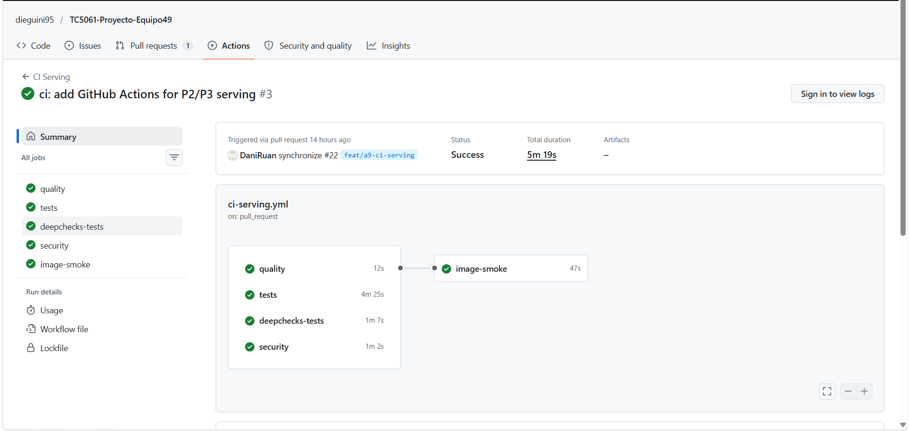
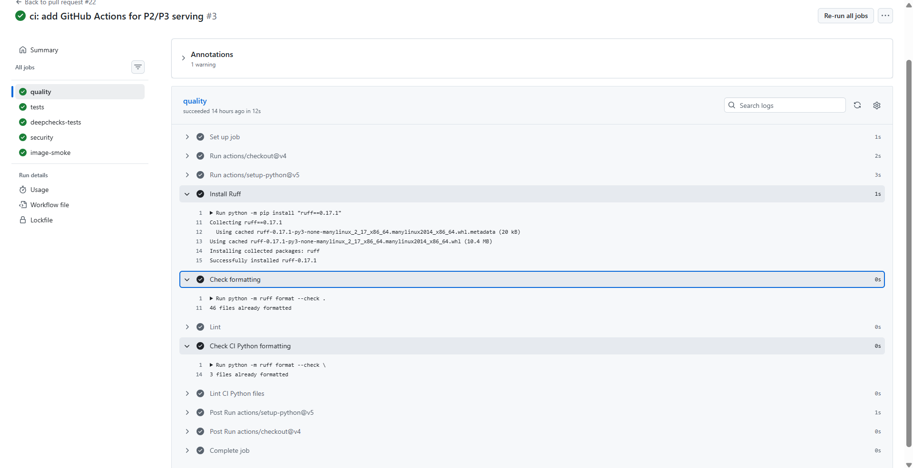
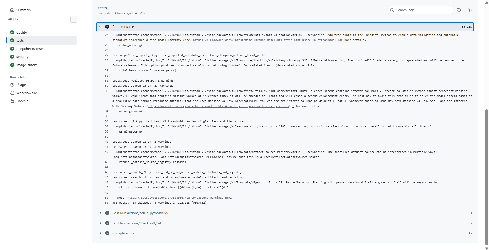
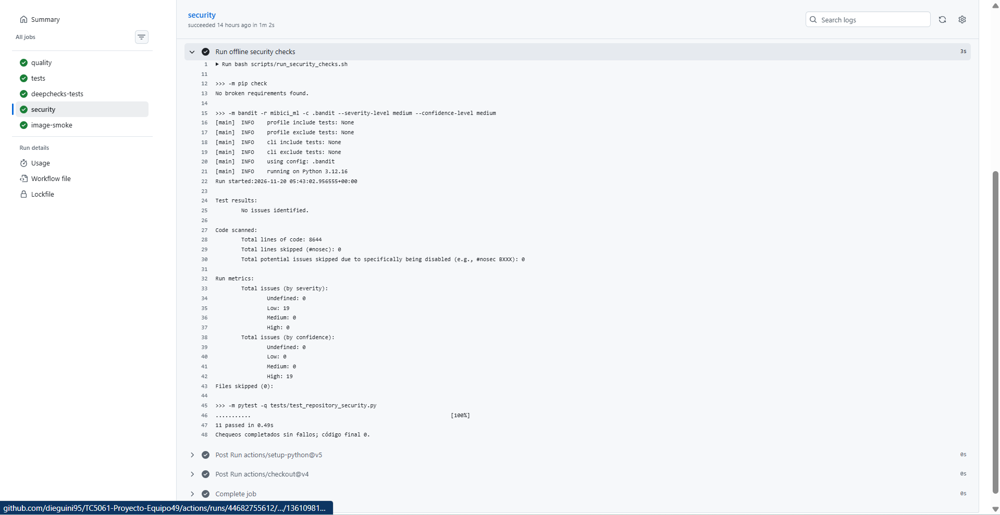
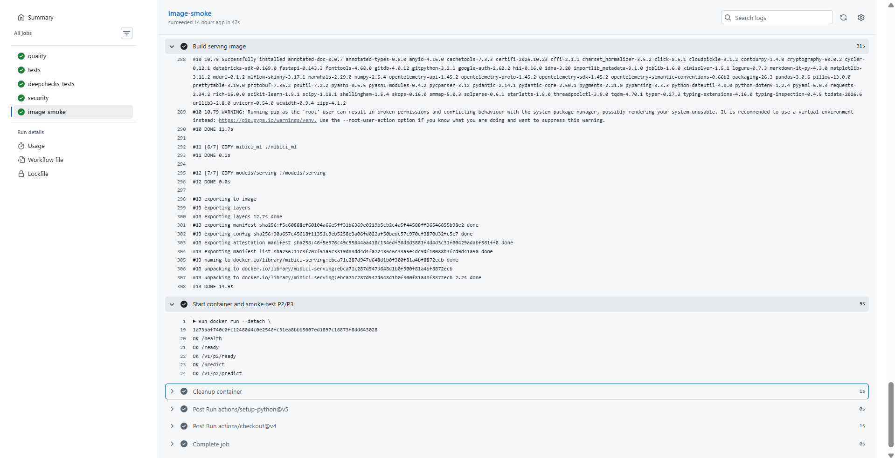

# Actividad 9 - CI Serving P2/P3

## 1. Alcance implementado

El workflow [CI Serving](../../../.github/workflows/ci-serving.yml) automatiza el formato y lint con Ruff, la suite PyTest, pruebas DeepChecks en un entorno aislado, chequeos de seguridad offline, la construcción de la imagen desde `Containerfile` y un smoke test del serving P2/P3. El contenedor se limpia incluso si falla el smoke.

La imagen se usa exclusivamente en el runner hospedado por GitHub: no se publica en un registro ni se despliega. El workflow no utiliza secretos. Compose, Locust y FinOps no forman parte del alcance de este PR. `pip-audit` no forma parte del gate; estos resultados no afirman que las dependencias estén libres de vulnerabilidades.

## 2. Datos de la ejecución

| Dato | Valor |
|---|---|
| Pull Request | [#22](https://github.com/dieguini95/TC5061-Proyecto-Equipo49/pull/22) |
| Workflow | `CI Serving` |
| Run | [44682755612](https://github.com/dieguini95/TC5061-Proyecto-Equipo49/actions/runs/44682755612) |
| Evento | `pull_request` (`synchronize`) |
| Commit de la rama probado | `9f753a6be0e9e0630529a1b3ada73b2b18a0b3f8` |
| Conclusión | `success` |
| Duración total | 5 min 19 s |
| Inicio y término | 2026-11-20 05:42:02–05:47:21 UTC |

## 3. Eventos, permisos y concurrencia

El workflow se activa en pull requests dirigidos a `main`, pushes a `main` y ejecuciones manuales mediante `workflow_dispatch`. Declara únicamente `contents: read`; la concurrencia agrupa ejecuciones por workflow y referencia y cancela la ejecución anterior cuando aplica (`cancel-in-progress: true`). Los límites son 10 minutos para `quality`, 20 para `tests`, 20 para `deepchecks-tests`, 15 para `security` y 25 para `image-smoke`.

No utiliza `pull_request_target`, permisos de escritura ni secretos.

## 4. Jobs ejecutados

| Job | Resultado | Duración | Función |
|---|---|---:|---|
| `quality` | `success` | 12 s | Ruff format y lint globales, más formato y lint de Python del CI. |
| `tests` | `success` | 4 min 25 s | Suite PyTest del repositorio. |
| `deepchecks-tests` | `success` | 1 min 7 s | Pruebas deterministas de calidad de datos en entorno aislado. |
| `security` | `success` | 1 min 2 s | `pip check`, Bandit y pruebas de higiene del repositorio. |
| `image-smoke` | `success` | 47 s | Build OCI, smoke del serving P2/P3 y cleanup; depende de los otros cuatro jobs. |

## 5. Calidad y pruebas

Ruff aprobó el formato (`ruff format --check .`) y el lint (`ruff check .`), además de los archivos Python del CI. La suite terminó con **361 passed, 13 skipped y 44 warnings**. La prueba CLI verifica el error requerido de `--final-k` y normaliza secuencias ANSI para que la aserción sea estable sin debilitar el mensaje comprobado.

Los gates se ejecutaron normalmente: ninguno se eliminó ni se relajó y no se usó `continue-on-error`.

## 6. Seguridad

- `pip check`: aprobado, sin requisitos rotos.
- Bandit: 0 hallazgos medium, 0 high y 19 low.
- Higiene del repositorio: 11 pruebas aprobadas.
- `pip-audit` no forma parte del gate; no se declara ausencia de vulnerabilidades.

## 7. Build y smoke

`image-smoke` construyó la imagen desde `Containerfile`, con el tag temporal de CI `mibici-serving:ebca71c287d947d648d1b0f300f81a4bf8872ecb` (`IMAGE_TAG` usa `github.sha`). El contenedor expuso el puerto únicamente en loopback (`127.0.0.1:8000`). El smoke ejercitó el serving empaquetado real de P2/P3, no respuestas falsas. La imagen no se publicó y no hubo despliegue.

## 8. Resultados del smoke

| Comprobación | Resultado |
|---|---|
| Build de imagen | `success` |
| `/health` | HTTP 200 |
| `/ready` | HTTP 200 |
| `/v1/p2/ready` | HTTP 200 |
| `/predict` (P3) | HTTP 200 |
| `/v1/p2/predict` (P2) | HTTP 200 |
| Recolección de logs | `success` |
| Cleanup del contenedor | `success` |

## 9. Evidencia visual

Las cinco capturas corresponden al run 44682755612 del PR #22 y muestran sus jobs completados correctamente.

| Figura | Archivo | Qué demuestra |
|---|---|---|
| 1 | [01_ci_workflow_green.png](./01_ci_workflow_green.png) | Resumen verde del workflow con los cinco jobs exitosos. |
| 2 | [02_ci_quality.png](./02_ci_quality.png) | Gates de formato y lint ejecutados con Ruff. |
| 3 | [03_ci_tests.png](./03_ci_tests.png) | Suite PyTest: 361 aprobadas, 13 omitidas y 44 warnings. |
| 4 | [04_ci_security.png](./04_ci_security.png) | `pip check`, resultados Bandit y pruebas de higiene. |
| 5 | [05_ci_image_smoke.png](./05_ci_image_smoke.png) | Build de imagen, respuestas de los endpoints y cleanup. |

## 10. Figuras

*Figura 1. Ejecución exitosa del workflow `CI Serving` asociada al commit `9f753a6`, con los cinco jobs completados.*

*Figura 2. Validación automática del formato y análisis estático del repositorio mediante Ruff.*

*Figura 3. Ejecución de la suite PyTest en GitHub Actions, con 361 pruebas aprobadas y 13 omitidas.*

*Figura 4. Gate de seguridad offline con dependencias consistentes, Bandit sin hallazgos medios o altos y pruebas de higiene aprobadas.*

*Figura 5. Construcción y ejecución de la imagen de serving, con validación de health, readiness y predicciones contractuales de P3 y P2.*

## 11. Correcciones validadas por CI

El script `scripts/ci_smoke_serving.py` tiene modo ejecutable `100755`, acorde con su shebang. El test de CLI elimina secuencias ANSI antes de comprobar el mensaje obligatorio y cuenta con cobertura específica que conserva el argumento y el texto significativo.

El run final completó los cinco jobs con `success`; ningún gate fue eliminado o relajado.

## 12. Aporte a la actividad

La contribución automatiza las pruebas y construye la imagen durante CI; el run documentado demuestra un pipeline exitoso. Añade controles de formato, lint, seguridad offline y smoke test, y aporta evidencia para el 25% de CI/CD de la rúbrica. La imagen integra los modelos reales empaquetados P2/P3 y el smoke valida sus endpoints sin sustituir el serving por fakes.

## 13. Alcance verificado

El workflow construyó y ejecutó la imagen real del repositorio en un runner hospedado por GitHub, comprobó disponibilidad y predicción para P2 y P3 y eliminó el contenedor de forma controlada. Los cinco jobs terminaron correctamente. La imagen se utilizó únicamente dentro del runner, sin publicación en un registro y sin despliegue externo.
