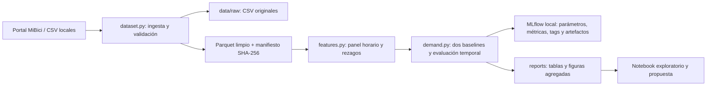

# P1 — Pronóstico de salidas por estación y hora

**TC5061 · Equipo 49 · Responsable de P1: Saúl Salgado Ortega**

**Entrega 1 · Implementación local · 18 de octubre de 2026**

Este documento desarrolla el apartado P1 del ML Canvas del equipo. Complementa el Canvas y la arquitectura existentes; no reemplaza los apartados de P2 y P3. Los resultados provienen de la ejecución del código del repositorio y se conservan en MLflow local.

## 1. Formulación y valor para la operación

**Pregunta:** ¿cuántos viajes se iniciarán en cada estación en un periodo futuro?

La tarea es una regresión de conteos. La unidad de observación es una estación durante una hora local de Guadalajara. La variable objetivo `departures` cuenta las salidas válidas en el intervalo `[hora, hora + 1 h)`. A las **00:00 de cada día** se producen 24 predicciones por estación con historia suficiente, una para cada hora del día que empieza. Por ejemplo, a las 00:00 del lunes se pronostican las salidas del lunes de 08:00 a 09:00 empleando información disponible al emitir el pronóstico.

El operador del sistema utilizaría el perfil previsto para preparar la distribución de bicicletas y priorizar estaciones y horarios con mayor actividad. El error absoluto, medido en viajes por estación-hora, permite valorar si un pronóstico es útil para esa planeación. Esta entrega prueba la viabilidad del pronóstico; no calcula rutas de rebalanceo ni cantidades óptimas de inventario.

**Alcance del objetivo:** se predicen viajes observados, no demanda latente. Una estación sin bicicletas puede registrar cero salidas pese a existir demanda insatisfecha. Los CSV históricos no permiten identificar todos esos casos.

## 2. Datos, procedencia y tratamiento

Se utilizan los **12 meses de octubre de 2025 a septiembre de 2026** para capturar ciclos semanales y variación anual sin depender de esquemas muy antiguos. Los CSV mensuales y la nomenclatura de septiembre de 2026 proceden del [portal de datos abiertos de MiBici](https://mibici.net/es/datos-abiertos/). Los enlaces concretos, tamaños, conteos y hashes SHA-256 de los archivos utilizados se registran en el manifiesto de ingesta; `data_version` identifica la entrada del experimento.

La ingesta confirmó **4,497,877 registros crudos** y produjo **4,493,328 viajes limpios**. Se excluyeron 4,549 filas: 758 duplicados exactos y 3,791 viajes con duración no positiva. Las otras reglas de exclusión no descartaron filas en esta versión. Se conservan 484 estaciones en el catálogo y se observan **471 identificadores distintos de origen en el historial**. Son universos diferentes: no se usan los 484 registros del catálogo como si todos hubieran estado activos durante el año. Los conteos y hashes por archivo están en `references/data_manifest.json`; la cobertura del experimento está en `reports/tables/p1_quality.json`.

| Variable de origen | Uso en P1 |
|---|---|
| Identificador de viaje | Inspeccionar identificadores repetidos; los duplicados se eliminan por igualdad de la fila completa. No es predictor |
| Fecha y hora de inicio | Ubicar cada salida en su hora y construir el objetivo |
| Estación de origen | Identificar la serie temporal de salidas |
| Fecha de fin y estación de destino | Validación/preparación compartida; no son predictores futuros |
| Catálogo de estaciones | Referencia e inspección del inventario de estaciones |
| Género, año de nacimiento y otros campos del usuario | No se requieren y se excluyen de los datos preparados para P1 |

La ingesta conserva los originales únicamente en `data/raw/`, normaliza encabezados/codificación y fechas, verifica los meses solicitados y genera Parquet. El manifiesto registra por mes las reglas aplicadas y cuántas filas afecta cada una: duplicados exactos, fechas no interpretables, duración no positiva, identificadores de estación inválidos e inicios fuera del mes del archivo. Un identificador de viaje repetido con contenido distinto se reporta y se conserva; no se presume que sea el mismo viaje. Se mantienen viajes de duración positiva corta o larga y los de igual origen y destino: pueden constituir salidas válidas aunque no sean útiles para otro análisis.

**Condiciones publicadas y privacidad.** La página de MiBici ofrece descargas y promueve su exploración; en la consulta del 18 de octubre de 2026 no se identificó una licencia de reutilización específica en esa página. Se enlazan los [términos publicados](https://mibici.net/es/termino-y-condiciones/) y el [aviso de privacidad](https://mibici.net/es/aviso-de-privacidad/). Los términos tratan el uso del servicio de bicicletas; no se presentan aquí como una licencia abierta para los CSV. La licencia MIT del repositorio aplica al código. El uso del equipo es académico, se atribuye la fuente y no se publican registros de viajes o usuarios en Git ni en artefactos de MLflow: las salidas compartibles son métricas, conteos y gráficas agregadas.

## 3. Partición y prevención de fuga temporal

| Partición | Fechas inclusivas | Uso |
|---|---|---|
| Entrenamiento / historia inicial | 2025-10-01 a 2026-06-30 | Historia de los baselines; futuro ajuste de candidatos |
| Validación | 2026-07-01 a 2026-08-31 | Comparar los dos baselines y elegir por WAPE |
| Prueba | 2026-09-01 a 2026-09-30 | Evaluar los modelos ya definidos, sin ajustar con este mes |

La evaluación simula un pronóstico emitido cada medianoche. Puede usar salidas de días anteriores de validación o prueba porque esas observaciones ya serían conocidas en ese momento. Nunca usa salidas del mismo día que se pronostica. No es una predicción única de todo septiembre emitida el 31 de agosto.

El panel mantiene una cuadrícula horaria regular y los rezagos representan horas reales transcurridas. No se desplazan filas después de borrar días. Se exige historia suficiente para comparar los dos baselines sobre las **mismas filas**, con 28 días completos de antecedentes. Las filas excluidas y la cobertura se reportan. El primer día observado de cada estación se considera incompleto y se deja sin etiqueta, igual que los días anteriores; la estación es conocida desde la siguiente medianoche. La primera observación aproxima disponibilidad, no una fecha oficial de inauguración. La nomenclatura de septiembre no demuestra que todas sus estaciones existieran durante el año completo.

## 4. Pipeline y arquitectura de P1



Python permite mantener un único módulo reproducible; la preparación procesa un mes a la vez para evitar cargar simultáneamente todos los viajes. Los hashes y descargas se calculan por bloques. Parquet reduce espacio y facilita lecturas columnares: para agregar salidas se leen únicamente origen y fecha de inicio. Un manifiesto pequeño en Git conserva la identidad de los datos sin añadir los CSV al historial. MLflow vincula las decisiones, los datos y los resultados de cada ejecución. La organización sigue las carpetas de Cookiecutter Data Science: código en `mibici_ml/`, datos locales en `data/`, exploración en `notebooks/` y salidas agregadas en `reports/`.

Las funciones documentadas de `features.py` construyen el conteo estación-hora, calendario y rezagos. El notebook **solo inspecciona** resultados producidos por el módulo y los resúmenes existentes; no es necesario ejecutarlo para reproducir el experimento.

| Variable construida | Pertinencia y disponibilidad |
|---|---|
| Hora, día de semana y fin de semana | Calendario conocido al emitir el pronóstico; describe ciclos de movilidad |
| Salidas de hace 24 y 48 horas | Actividad reciente; sus intervalos terminan a más tardar en la emisión diaria |
| Salidas de hace 168 horas | Misma hora del mismo día de la semana anterior |
| Media de rezagos de 168, 336, 504 y 672 horas | Patrón semanal suavizado con cuatro observaciones históricas |

La identidad de estación permite separar series. No se usa el total anual, una media centrada, observaciones del día pronosticado ni características calculadas con todo el conjunto como predictores.

## 5. Baselines, candidatos y métricas

**Implementados y comparados:**

1. **Estacional de 168 horas:** `pred(s,t) = y(s,t−168 h)`. Es una referencia interpretable para movilidad semanal.
2. **Media de cuatro semanas:** promedio de `y(s,t−168 h)`, `y(s,t−336 h)`, `y(s,t−504 h)` y `y(s,t−672 h)`. Reduce la variación de un único día, aunque puede reaccionar lentamente a cambios recientes.

Ambos son reglas deterministas, sin parámetros aprendidos. Se conservan predicciones fraccionarias para la evaluación: representan un conteo esperado y no una orden de asignación de bicicletas. No se requiere serializar un modelo entrenado para estos baselines.

**Candidatos propuestos para la siguiente iteración:** `PoissonRegressor`, como modelo de conteos interpretable con enlace logarítmico, y `HistGradientBoostingRegressor(loss="poisson")`, para interacciones no lineales entre calendario y rezagos. No se atribuyen métricas a estos candidatos porque esta ejecución mínima evalúa los dos baselines. Codificación, escalamiento y ajustes se aprenderán únicamente en entrenamiento; los hiperparámetros se seleccionarán mediante validación temporal.

| Métrica | Definición y utilidad |
|---|---|
| **MAE** | Promedio de `abs(real − predicción)`. Error operativo típico en viajes por estación-hora |
| **WAPE** | `sum(abs(real − predicción)) / sum(real)`. Error absoluto relativo al volumen observado; criterio de elección en validación |
| RMSE | Raíz del error cuadrático medio. Hace visibles errores grandes, relevantes ante picos |
| Sesgo (`bias`) | Promedio de `predicción − real`. Signo positivo: sobreestimación; negativo: subestimación |

WAPE se registra como razón: `0.50` equivale a `50 %`. Se controla el denominador nulo; no se transforma un caso indefinido en precisión perfecta. No se utiliza MAPE como métrica principal por las numerosas horas con cero viajes. MAE y WAPE sobre una cohorte idéntica ordenan los baselines de la misma manera. Las métricas agregadas deben acompañarse de tamaño de cohorte y gráficas: un promedio global puede ocultar errores en estaciones concurridas y horas pico.

## 6. Resultados y evidencia reproducible

<!-- P1_RESULTS_START -->
**Se ejecutaron y registraron los dos baselines con los doce meses originales.** Los valores siguientes proceden de `reports/tables/p1_metrics.csv`. MAE, RMSE y sesgo están expresados en viajes por estación-hora; WAPE se convierte de razón a porcentaje únicamente para presentar la tabla.

| Baseline | Partición | MAE | RMSE | WAPE | Sesgo |
|---|---|---:|---:|---:|---:|
| Semana anterior, 168 h | Validación | 0.928686 | 1.859359 | 76.1207 % | −0.004892 |
| **Media de 4 semanas** | **Validación** | **0.801140** | **1.505169** | **65.6663 %** | **−0.016029** |
| Semana anterior, 168 h | Prueba | 1.029693 | 2.112713 | 71.0105 % | −0.117341 |
| **Media de 4 semanas** | **Prueba** | **0.880552** | **1.741212** | **60.7254 %** | **−0.223650** |

La **media de cuatro semanas** se seleccionó exclusivamente por su menor WAPE de validación. Frente al baseline de la semana anterior, reduce el MAE un **13.73 % en validación** y un **14.48 % en prueba**, calculado como `(MAE_estacional − MAE_media) / MAE_estacional`. La mejora en prueba describe el desempeño del modelo ya elegido; septiembre no se utiliza para volver a seleccionarlo.

Un MAE de 0.880552 significa un error absoluto medio de aproximadamente **0.88 viajes por estación-hora** en la cohorte de prueba. WAPE de 60.7254 % significa que el error absoluto acumulado equivale al 60.7254 % de los viajes observados; **no es un porcentaje de aciertos**. La media suaviza variación semanal y reduce los errores medios, pero presenta mayor subestimación neta en septiembre: prevé 412,661.25 viajes frente a 487,915 observados en la cohorte, una diferencia de −75,253.75 (−15.42 %). Es una referencia inicial útil para comparar futuros modelos, no evidencia de que el pronóstico ya sea suficiente para asignar flota.

| Cobertura | Validación | Prueba |
|---|---:|---:|
| Estaciones-hora conocidas al emitir | 673,656 | 338,856 |
| Estaciones-hora evaluadas por ambos baselines | 629,424 | 336,480 |
| Excluidas por historia insuficiente | 44,232 | 2,376 |
| Cobertura de filas conocidas | 93.43 % | 99.30 % |
| Estaciones distintas con alguna fila evaluada | 455 | 470 |
| Viajes observados en la cohorte | 767,908 | 487,915 |
| Horas evaluadas con cero salidas | 56.44 % | 53.82 % |

El panel de almacenamiento tiene **4,125,960 filas** (471 estaciones × 8,760 horas). Incluye filas sin etiqueta anteriores a la disponibilidad de la estación y no equivale al tamaño evaluado. En prueba hay 470 estaciones evaluadas aunque solo 468 tuvieron alguna salida en septiembre: una estación conocida puede permanecer en la cohorte y registrar ceros. Sin historial de cierres, esos ceros no prueban que estuviera abierta. Las estaciones con menos de cuatro semanas de historia se excluyen y deben tratarse por separado en una futura solución operativa.

La versión de datos de esta ejecución es:

```text
0f000bd5e6563196d7c1133e119024e4e864f6325752e4f6b48e40011895d1a3
```

El manifiesto fija los hashes de los CSV y Parquet. Antes de evaluar, el módulo verifica el rango, la lista exacta de meses, las rutas esperadas, la identidad del manifiesto y los hashes de los archivos procesados. Así evita asociar un run con una versión de datos distinta de los archivos leídos.

| Run de MLflow | Identificador |
|---|---|
| `P1-estacional-168h` | `afb77ec9c5904efd9e9c059376d7b90b` |
| `P1-media-4semanas` | `15d5969c45f54aadb44b80b8f0aa8563` |

Ambos pertenecen al experimento `mibici-equipo49`, identificador local `404903470010940206`. Los IDs también se guardan en `reports/tables/p1_runs.json`.
<!-- P1_RESULTS_END -->

Cada run registra fechas, `data_version`, semilla, rezagos y protocolo. Las métricas distinguen `val_*` de `test_*`. Las etiquetas identifican equipo, pregunta y el commit de implementación `52af95c13416705906f0630f058a4c78645a2fbe`, con `git_dirty=false`. La versión de fuentes es `25f9a8265b0c28941d6e83bb92c45a5c2a15ccf69c0cf21f4fc9e01c12da5c7c`. El artefacto `reproducibility/code_snapshot.zip` conserva módulos, dependencias, README y licencia; `code_provenance.json` fija hashes del código y del contexto documental por separado. Las capturas corresponden a estos runs finales; las corridas preliminares siguen conservadas como historial local.

Artefactos principales:

- `reports/tables/p1_quality.json`: calidad, versión de datos y cobertura de evaluación.
- `reports/tables/p1_metrics.csv`: comparación de modelos y particiones.
- `reports/tables/p1_station_metrics.csv`: errores por estación en prueba.
- `reports/figures/P1_error_comparison.png`: comparación de error.
- `reports/figures/P1_daily_totals.png`: evolución de totales observados y pronosticados.
- `reports/figures/P1_station_example.png`: comportamiento de una estación de ejemplo.

La evidencia de interfaz que acompaña este apartado se organiza en `reports/figures/`: `P1_mlflow_runs.png` (lista), `P1_mlflow_detail.png` (identificación y etiquetas), `P1_mlflow_metrics.png` (métricas y parámetros del mismo run), `P1_mlflow_artifact.png` (artefacto) y `P1_mlflow_comparison.png` (comparación). Quedan disponibles para integrar el entregable conjunto; las figuras de predicciones son artefactos del experimento y cumplen un propósito diferente al de esas capturas.

## 7. Cómo reproducirlo

Con Python 3.12 y el entorno instalado según el README, desde la raíz del repositorio:

```powershell
# Descarga los archivos faltantes y prepara datos/manifiesto.
python -m mibici_ml.dataset

# Alternativa: reutiliza los originales disponibles localmente.
python -m mibici_ml.dataset --source-dir "C:\ruta\a\los\CSV"

# Construye variables, evalúa los baselines y registra MLflow.
python -m mibici_ml.modeling.demand
```

Los dos comandos de ingesta son alternativas. El README documenta la instalación fijada y el arranque de la interfaz local de MLflow. El contrato diario valida 24 horas, emisión a medianoche y rezagos de al menos 24 horas antes de leer datos o registrar MLflow. Las fechas, rutas y semillas se centralizan en `mibici_ml/config.py`; no se necesita copiar transformaciones desde el notebook ni mover archivos manualmente para una ejecución con descarga.

## 8. Limitaciones y siguiente iteración

- La primera salida observada aproxima la entrada en operación. Sin un historial oficial de aperturas, cierres y fallas, algunos ceros pueden representar indisponibilidad.
- El catálogo es una fotografía de septiembre de 2026. Capacidad y ubicación históricas no se infieren de esa fotografía para entrenar P1.
- Los términos de servicio actuales señalan que no se liberan bicicletas entre 01:00 y 04:59. El panel conserva las 24 horas; muchos ceros son estructurales. La siguiente evaluación debe examinar además el error en horas operativas, sin asumir que el horario actual prueba el horario histórico.
- No se incluyen clima, festividades, eventos, stock ni rebalanceos. Su ausencia limita la respuesta a cambios de demanda.
- La cohorte común con 28 días de historia no resuelve estaciones nuevas. Para producción falta definir una estrategia de arranque y medirla por separado.
- Es una evaluación retrospectiva con archivos mensuales. Operación diaria requeriría una fuente con actualización diaria y verificación de cuándo está disponible cada dato.
- Faltan integrar los resultados de P2/P3, la revisión del equipo y la evidencia individual de colaboración en el entregable conjunto. La publicación de P1 se realiza mediante Pull Request desde la rama Saul, con revisión del equipo antes de fusionar.

## Referencias

MiBici. (s. f.). *Datos abiertos*. Recuperado el 18 de octubre de 2026, de https://mibici.net/es/datos-abiertos/

MiBici. (s. f.). *Términos y condiciones*. Recuperado el 18 de octubre de 2026, de https://mibici.net/es/termino-y-condiciones/

MiBici. (s. f.). *Aviso de privacidad*. Recuperado el 18 de octubre de 2026, de https://mibici.net/es/aviso-de-privacidad/

The scikit-learn developers. (s. f.). *Lagged features for time series forecasting*. https://scikit-learn.org/stable/auto_examples/applications/plot_time_series_lagged_features.html

The scikit-learn developers. (s. f.). *Metrics and scoring: Quantifying the quality of predictions*. https://scikit-learn.org/stable/modules/model_evaluation.html

The scikit-learn developers. (s. f.). *PoissonRegressor*. https://scikit-learn.org/stable/modules/generated/sklearn.linear_model.PoissonRegressor.html

MLflow. (s. f.). *ML experiment tracking*. https://mlflow.org/docs/latest/ml/tracking/

DrivenData. (s. f.). *Cookiecutter Data Science*. https://cookiecutter-data-science.drivendata.org/
